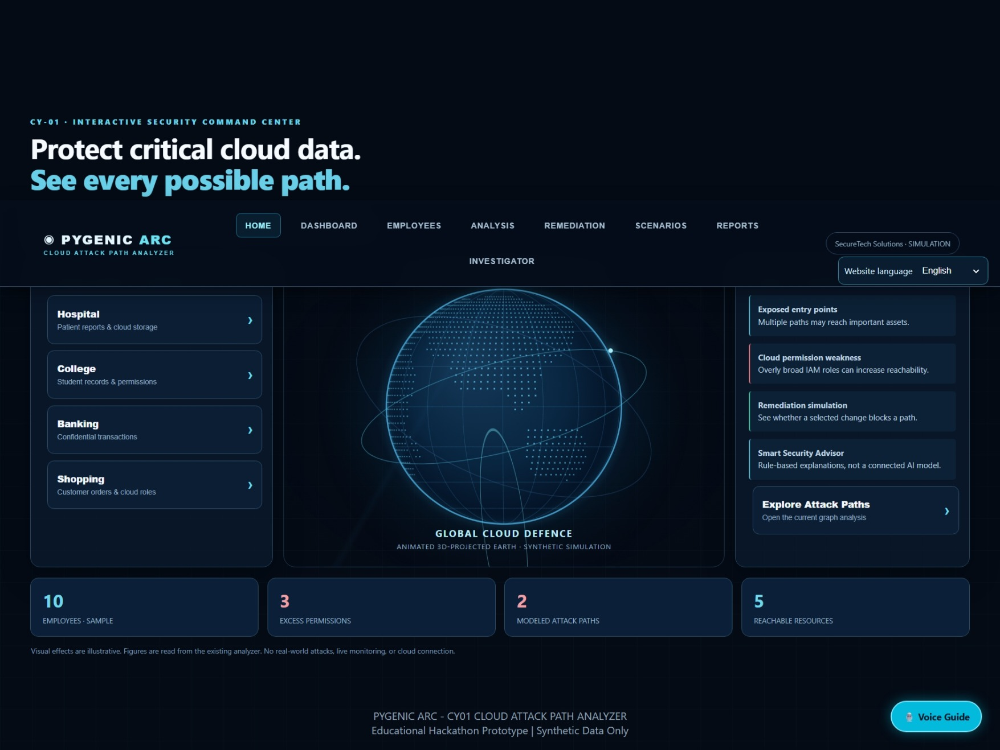

# Pygenic-Arc-Hackathon-2026
🚀 Pygenic Arc | Cloud Attack Path Analyzer — A cybersecurity hackathon project that identifies cloud misconfigurations, analyzes attack paths, prioritizes risks, and recommends security fixes.
# 🚀 Pygenic Arc – Cloud Attack Path Analyzer

## 🏆 My First Hackathon Experience

Proud to have successfully completed my first
24-hour hackathon as a Team Leader!

This experience was an incredible opportunity
to explore cybersecurity, improve my technical
skills, and develop teamwork and leadership abilities.

## 💡 About the Project

Pygenic Arc is a Cloud Attack Path Analyzer designed
to identify potential security risks in cloud environments.

The project analyzes sample cloud configuration data
to identify misconfigurations, excessive permissions,
and possible attack paths to critical assets.

It also recommends security improvements to help
reduce potential risks.

## 🎯 Problem Statement

Cloud environments can contain security weaknesses
that attackers may exploit.

Our solution focuses on identifying connected
security weaknesses and suggesting ways to fix them.

## ⚙️ Technologies Used

- HTML
- CSS
- JavaScript
- JSON
- GitHub

## ✨ Key Features

- Cloud Misconfiguration Detection
- Attack Path Visualization
- Security Risk Analysis
- Risk Prioritization
- Remediation Recommendations
- Interactive Dashboard

## 👩‍💻 My Role – Team Leader

As the team leader, I participated in:

- Project planning and coordination
- Team collaboration
- Website development
- Problem-solving
- Project demonstration

## 🌟 What I Learned

This hackathon helped me improve my:

- Leadership skills
- Technical knowledge
- Communication skills
- Teamwork
- Problem-solving abilities
- Confidence in building real-world projects

## ❤️ Acknowledgement

Grateful to my teammates, mentors, and hackathon
organizers for making this experience memorable.

This project represents our collective effort,
dedication, and learning.

## 📌 Note

This repository showcases our hackathon project.
The original source code is maintained separately
in a private team repository.
## 📸 My Hackathon Project Screenshots

### 🏠 Pygenic Arc Website

---

## 🌐 Live Project Demo

🚀 Explore our Pygenic Arc – Cloud Attack Path Analyzer!

🔗 [Click Here to Visit Our Live Website](https://pygenic-arc.netlify.app/)

### ✨ Website Features

- Interactive Cloud Security Dashboard
- Cloud Attack Path Visualization
- Employee Permission Detection
- Security Risk Analysis
- Remediation Simulator
- Automated Investigation
- Security Reports

### 💻 Project Information

**Project:** Pygenic Arc – Cloud Attack Path Analyzer

**Hackathon:** Anvation 2026

**Team Leader:** Sahana M

**Project Type:** Cybersecurity Web Application

**Note:** This is an educational prototype using synthetic cloud configuration data.
